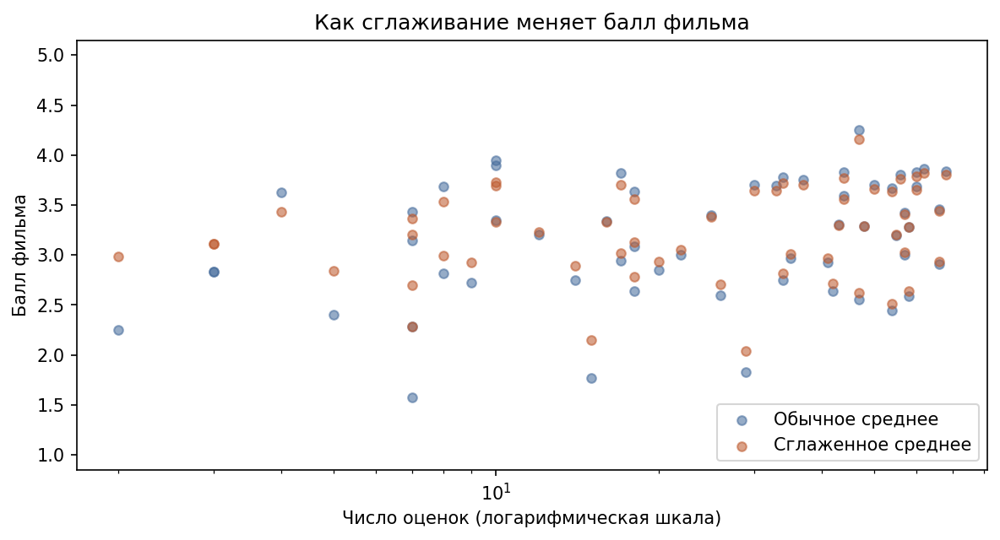

# Вес голоса · ФильмРейтинг

У одного фильма единственный зритель поставил пятёрку. У другого средняя оценка 4,5 по сотне голосов. Какой балл лучше предсказывает, что поставит следующий зритель? На этот вопрос можно ответить, если рассчитать оба рейтинга по прошлым оценкам и проверить их на более поздних.

В реальном кинокаталоге такое сравнение зависит от способа подсчёта. Например, IMDb публикует взвешенную оценку и отдельно показывает распределение голосов. В проекте используется открытая учебная формула, для которой можно проверить каждый шаг на своих данных. [IMDb, Ratings FAQ](https://help.imdb.com/article/imdb/track-movies-tv/faq-for-imdb-votes/G67Y87TFYYP6TWAV)

**Первая гипотеза.** Среднее конкретного фильма лучше предсказывает его следующую оценку, чем среднее по всем голосам каталога. **Вторая гипотеза.** Для фильмов с 1–9 прошлыми голосами сглаживание к общему среднему снижает ошибку прогноза.

## Данные и постановка опыта

Запасной вариант включает 60 фильмов, 100 зрителей и 3000 вымышленных оценок за 180 дней. Базовый балл фильма и вес его популярности выбираются независимо. Популярные фильмы чаще получают голоса. У каждого зрителя есть постоянная склонность завышать или занижать баллы. К базовому баллу прибавляются это смещение и случайный шум, затем результат округляется с шагом 0,5 и ограничивается диапазоном от 1 до 5. Каждый зритель может оценить конкретный фильм один раз. Прогнозы строятся по зарегистрированным оценкам. Скрытые параметры хранятся отдельно.

Границы разбиения проведены по датам в пропорции примерно 60/20/20. Все голоса одного дня входят в одну часть. Обучение даёт исходные рейтинги, валидация служит для выбора силы сглаживания, тест — для окончательного сравнения. При такой постановке для прогноза доступны только более ранние наблюдения. Тот же принцип лежит в основе проверки с последовательным сдвигом временной границы. [Hyndman, Athanasopoulos, «Time series cross-validation»](https://otexts.com/fpp3/tscv.html)

| Часть | Оценок | Доля | Первая дата | Последняя дата |
| --- | --- | --- | --- | --- |
| Обучение | 1807 | 60,2% | 2025-01-01 | 2025-04-20 |
| Валидация | 599 | 20,0% | 2025-04-21 | 2025-05-25 |
| Тест | 594 | 19,8% | 2025-05-26 | 2025-06-29 |

## Как один фильм оказывается в четырёх разных списках

| Сортировка | Первое место | Голосов | Средний балл | После сглаживания |
| --- | --- | --- | --- | --- |
| По числу оценок | У кондуктора алиби | 68 | 3,84 | 3,80 |
| По среднему баллу | Шлюпка под брезентом | 47 | 4,26 | 4,16 |
| По среднему баллу при 20+ оценках | Шлюпка под брезентом | 47 | 4,26 | 4,16 |
| По сглаженному баллу | Шлюпка под брезентом | 47 | 4,26 | 4,16 |

У десяти лидеров по числу голосов и десяти лидеров по среднему баллу число общих фильмов равно 3. Первый список измеряет популярность, второй отражает мнение проголосовавших зрителей. Порог в 20 голосов исключает слабо оценённые фильмы из списка. Сглаживание сохраняет их в сравнении и учитывает объём истории в самом балле. Полные списки лежат в `results/rankings/`.

## Сглаживание и выбор коэффициента

Для фильма с суммой оценок *S* и числом голосов *n* сглаженный балл равен **(S + α × μ) / (n + α)**. Здесь μ — среднее по всем прошлым голосам. Коэффициент α показывает, сколько условных голосов со средним баллом каталога добавлено к истории фильма. При нулевой истории прогноз равен μ. Контрольный расчёт при сумме 8, двух голосах, μ = 3 и α = 2 даёт (8 + 2 × 3) / (2 + 2) = **3,5**.

| α | RMSE на валидации | MAE на валидации |
| --- | --- | --- |
| 5 | 0,9990 | 0,8331 |
| 20 | 1,0228 | 0,8517 |
| 50 | 1,0522 | 0,8745 |

По валидационной RMSE выбран **α = 5**. Если значения отличаются от минимума не более чем на 0,001, выбирается больший α. У фильма «Река за пазухой» в обучении число голосов равно 8, их сумма — 29,5, а μ = 3,285. После сглаживания балл равен (29,5 + 5 × 3,285) / (8 + 5) ≈ **3,53**. Место этого фильма в обычном рейтинге — 15, в сглаженном — 19.

## Что произошло на тесте

После выбора α средние пересчитаны по обучению и валидации вместе и зафиксированы до конца теста. Каждый метод прогнозирует одни и те же оценки. В ячейках приведены **RMSE / MAE** в баллах. MAE показывает среднюю абсолютную ошибку, RMSE придаёт больший вес крупным промахам. Чем меньше значение, тем точнее прогноз.

| Прошлых голосов | Оценок в тесте | Общее среднее | Среднее фильма | Сглаженное среднее |
| --- | --- | --- | --- | --- |
| Все | 594 | 1,1411 / 0,9560 | 1,0130 / 0,8278 | 1,0110 / 0,8297 |
| 0 | 0 | нет наблюдений | нет наблюдений | нет наблюдений |
| 1–9 | 17 | 1,0636 / 0,8604 | 1,1038 / 0,9590 | 1,0432 / 0,8921 |
| 10+ | 577 | 1,1433 / 0,9589 | 1,0102 / 0,8239 | 1,0101 / 0,8279 |

Чтобы увидеть типичную ошибку, для каждого тестового голоса из абсолютной ошибки обычного среднего вычтена ошибка сглаженного. Положительная разница означает выигрыш от сглаживания. В последней колонке — медиана этих разниц в баллах.

| Прошлых голосов | Оценок | Точнее после сглаживания | Хуже | Без изменения | Медианный выигрыш |
| --- | --- | --- | --- | --- | --- |
| 0 | 0 | 0 | 0 | 0 | — |
| 1–9 | 17 | 10 | 7 | 0 | 0,093 |
| 10+ | 577 | 270 | 307 | 0 | -0,004 |

На фильмы с десятью и более прошлыми голосами пришлось 577 из 594 тестовых оценок. Поэтому небольшая группа фильмов с малым числом голосов слабо влияет на общую RMSE, даже когда для отдельного прогноза поправка заметна.

## Проверка на других периодах и историях голосования

Для каждого раннего периода коэффициент выбран заново на последних 20% предшествующих дат. После выбора средние рассчитаны по всей истории, доступной к началу этого периода. В таблице приведены результаты для фильмов с 1–9 прошлыми голосами.

| С | По | Выбранный α | Оценок | RMSE среднего фильма | RMSE сглаживания |
| --- | --- | --- | --- | --- | --- |
| 2025-04-01 | 2025-04-19 | 5 | 20 | 1,2430 | 1,0183 |
| 2025-04-20 | 2025-05-07 | 5 | 14 | 1,1066 | 1,1933 |
| 2025-05-08 | 2025-05-25 | 5 | 6 | 0,8652 | 1,0079 |

## Почему жанры получили разные баллы

| Жанр | Фильмов в каталоге | Оценок в обучении | Средний балл |
| --- | --- | --- | --- |
| Детектив | 12 | 412 | 3,63 |
| Драма | 12 | 407 | 3,11 |
| Комедия | 12 | 291 | 2,92 |
| Приключения | 12 | 244 | 3,39 |
| Фантастика | 12 | 453 | 3,31 |

Жанровое среднее рассчитано по отдельным голосам, поэтому популярные фильмы сильнее влияют на результат своего жанра. Жанр присвоен независимо от качества фильма. Эти различия описывают состав конкретной выборки.

## Разброс результата и выводы

В таблице Δ RMSE равна RMSE сглаженного прогноза минус RMSE среднего фильма. Отрицательное значение означает выигрыш от сглаживания. Внутри каждой группы проведён парный бутстрэп по фильмам. При каждом повторе случайно выбирались фильмы с возвращением, причём в выборку попадали все их тестовые оценки и оба соответствующих прогноза. Нижняя и верхняя границы — процентили 2,5% и 97,5% полученных разниц.

| Прошлых голосов | Фильмов | Оценок | Δ RMSE | Нижняя граница | Верхняя граница |
| --- | --- | --- | --- | --- | --- |
| Все | 56 | 594 | -0,0019 | -0,0100 | 0,0055 |
| 0 | 0 | 0 | — | — | — |
| 1–9 | 7 | 17 | -0,0606 | -0,2303 | 0,1238 |
| 10+ | 49 | 577 | -0,0001 | -0,0054 | 0,0047 |

**По первой гипотезе.** RMSE у метода «Среднее фильма» ниже, чем у метода «Общее среднее», на 0,1281 балла. Это сравнение относится к следующим голосам в заданной модели зрителей и фильмов.

**По второй гипотезе.** В группе с 1–9 голосами RMSE обычного среднего составила 1,1038, сглаженного — 1,0432. Оценок в тесте — 17, разных фильмов — 7. Интервал включает ноль. Знак разницы зависит от того, какие фильмы попали в выборку, поэтому уверенно переносить преимущество одного метода на новые фильмы пока рано.

Прогнозы зафиксированы на весь тест. Интервал характеризует разброс при смене состава фильмов. Зависимость между оценками одного зрителя у разных фильмов отдельно не моделируется. Для переноса выводов на реальный кинокаталог понадобятся наблюдения за его зрителями.

## Воспроизведение

Параметры генератора заданы в `config.json`, seed этого набора — 20261119. При запуске выполнено 20 автоматических проверок. Команды приведены в README.

## Вклад участников

| Участник | Что сделал или проверил |
| --- | --- |
|  |  |
|  |  |
|  |  |
|  |  |
