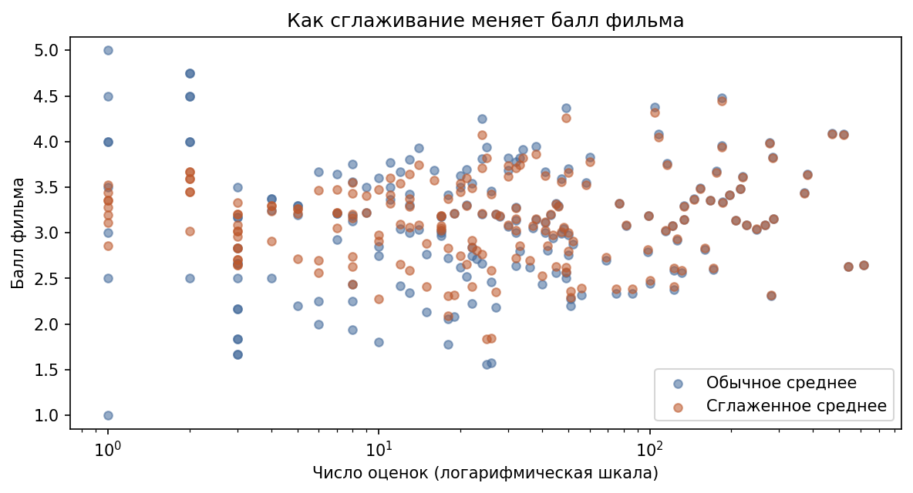

# РейтингФильм

У одного фильма единственный зритель поставил пятёрку. У другого средняя оценка 4,5 по сотне голосов. Какой балл лучше предсказывает, что поставит следующий зритель? На этот вопрос можно ответить, если рассчитать оба рейтинга по прошлым оценкам и проверить их на более поздних.

В реальном кинокаталоге такое сравнение зависит от способа подсчёта. Например, IMDb публикует взвешенную оценку и отдельно показывает распределение голосов. В проекте используется открытая учебная формула, для которой можно проверить каждый шаг на своих данных. [IMDb, Ratings FAQ](https://help.imdb.com/article/imdb/track-movies-tv/faq-for-imdb-votes/G67Y87TFYYP6TWAV)

**Первая гипотеза.** Среднее конкретного фильма лучше предсказывает его следующую оценку, чем среднее по всем голосам каталога. **Вторая гипотеза.** Для фильмов с 1–9 прошлыми голосами сглаживание к общему среднему снижает ошибку прогноза.

## Данные и постановка опыта

Основной вариант включает 200 фильмов, 1000 зрителей и 20000 вымышленных оценок за 360 дней. Базовый балл фильма и вес его популярности выбираются независимо. Популярные фильмы чаще получают голоса. У каждого зрителя есть постоянная склонность завышать или занижать баллы. К базовому баллу прибавляются это смещение и случайный шум, затем результат округляется с шагом 0,5 и ограничивается диапазоном от 1 до 5. Каждый зритель может оценить конкретный фильм один раз. Прогнозы строятся по зарегистрированным оценкам. Скрытые параметры хранятся отдельно.

Границы разбиения проведены по датам в пропорции примерно 60/20/20. Все голоса одного дня входят в одну часть. Обучение даёт исходные рейтинги, валидация служит для выбора силы сглаживания, тест — для окончательного сравнения. При такой постановке для прогноза доступны только более ранние наблюдения. Тот же принцип лежит в основе проверки с последовательным сдвигом временной границы. [Hyndman, Athanasopoulos, «Time series cross-validation»](https://otexts.com/fpp3/tscv.html)

| Часть | Оценок | Доля | Первая дата | Последняя дата |
| --- | --- | --- | --- | --- |
| Обучение | 12047 | 60,2% | 2025-01-01 | 2025-08-03 |
| Валидация | 3976 | 19,9% | 2025-08-04 | 2025-10-15 |
| Тест | 3977 | 19,9% | 2025-10-16 | 2025-12-26 |

## Как один фильм оказывается в четырёх разных списках

| Сортировка | Первое место | Голосов | Средний балл | После сглаживания |
| --- | --- | --- | --- | --- |
| По числу оценок | Эфир для Эридана | 616 | 2,64 | 2,65 |
| По среднему баллу | Соль на карте | 1 | 5,00 | 3,53 |
| По среднему баллу при 20+ оценках | Мел на манжете | 184 | 4,48 | 4,45 |
| По сглаженному баллу | Мел на манжете | 184 | 4,48 | 4,45 |

У десяти лидеров по числу голосов и десяти лидеров по среднему баллу число общих фильмов равно 0. Первый список измеряет популярность, второй отражает мнение проголосовавших зрителей. Порог в 20 голосов исключает слабо оценённые фильмы из списка. Сглаживание сохраняет их в сравнении и учитывает объём истории в самом балле. Полные списки лежат в `results/rankings/`.

## Сглаживание и выбор коэффициента

Для фильма с суммой оценок *S* и числом голосов *n* сглаженный балл равен **(S + α × μ) / (n + α)**. Здесь μ — среднее по всем прошлым голосам. Коэффициент α показывает, сколько условных голосов со средним баллом каталога добавлено к истории фильма. При нулевой истории прогноз равен μ. Контрольный расчёт при сумме 8, двух голосах, μ = 3 и α = 2 даёт (8 + 2 × 3) / (2 + 2) = **3,5**.

| α | RMSE на валидации | MAE на валидации |
| --- | --- | --- |
| 5 | 1,0012 | 0,8201 |
| 20 | 1,0071 | 0,8271 |
| 50 | 1,0196 | 0,8399 |

По валидационной RMSE выбран **α = 5**. Если значения отличаются от минимума не более чем на 0,001, выбирается больший α. У фильма «Соль на карте» в обучении число голосов равно 1, их сумма — 5,0, а μ = 3,231. После сглаживания балл равен (5,0 + 5 × 3,231) / (1 + 5) ≈ **3,53**. Место этого фильма в обычном рейтинге — 1, в сглаженном — 40.

## Что произошло на тесте

После выбора α средние пересчитаны по обучению и валидации вместе и зафиксированы до конца теста. Каждый метод прогнозирует одни и те же оценки. В ячейках приведены **RMSE / MAE** в баллах. MAE показывает среднюю абсолютную ошибку, RMSE придаёт больший вес крупным промахам. Чем меньше значение, тем точнее прогноз.

| Прошлых голосов | Оценок в тесте | Общее среднее | Среднее фильма | Сглаженное среднее |
| --- | --- | --- | --- | --- |
| Все | 3977 | 1,1734 / 0,9888 | 1,0243 / 0,8403 | 1,0233 / 0,8399 |
| 0 | 0 | нет наблюдений | нет наблюдений | нет наблюдений |
| 1–9 | 50 | 1,0509 / 0,8661 | 1,0983 / 0,9061 | 1,0129 / 0,8226 |
| 10+ | 3927 | 1,1749 / 0,9904 | 1,0233 / 0,8394 | 1,0235 / 0,8401 |

Чтобы увидеть типичную ошибку, для каждого тестового голоса из абсолютной ошибки обычного среднего вычтена ошибка сглаженного. Положительная разница означает выигрыш от сглаживания. В последней колонке — медиана этих разниц в баллах.

| Прошлых голосов | Оценок | Точнее после сглаживания | Хуже | Без изменения | Медианный выигрыш |
| --- | --- | --- | --- | --- | --- |
| 0 | 0 | 0 | 0 | 0 | — |
| 1–9 | 50 | 32 | 18 | 0 | 0,062 |
| 10+ | 3927 | 1827 | 2100 | 0 | -0,002 |

На фильмы с десятью и более прошлыми голосами пришлось 3927 из 3977 тестовых оценок. Поэтому небольшая группа фильмов с малым числом голосов слабо влияет на общую RMSE, даже когда для отдельного прогноза поправка заметна.

## Проверка на других периодах и историях голосования

Для каждого раннего периода коэффициент выбран заново на последних 20% предшествующих дат. После выбора средние рассчитаны по всей истории, доступной к началу этого периода. В таблице приведены результаты для фильмов с 1–9 прошлыми голосами.

| С | По | Выбранный α | Оценок | RMSE среднего фильма | RMSE сглаживания |
| --- | --- | --- | --- | --- | --- |
| 2025-06-30 | 2025-08-04 | 5 | 49 | 1,3481 | 1,1555 |
| 2025-08-05 | 2025-09-09 | 5 | 29 | 1,1911 | 1,1398 |
| 2025-09-10 | 2025-10-15 | 5 | 30 | 1,0464 | 0,9968 |

В дополнительном опыте каталог, скрытые параметры и выбранный α зафиксированы. Для каждой пары запусков генератор заново выбирает пары зритель–фильм и разыгрывает оценки. Число общих фильмов в двух десятках показывает, насколько устойчив их состав.

| Пара запусков | Совпадений в обычном топ-10 | В сглаженном топ-10 |
| --- | --- | --- |
| 8101 и 8102 | 2 | 9 |
| 8103 и 8104 | 4 | 8 |
| 8105 и 8106 | 5 | 6 |

## Почему жанры получили разные баллы

| Жанр | Фильмов в каталоге | Оценок в обучении | Средний балл |
| --- | --- | --- | --- |
| Детектив | 40 | 2802 | 3,53 |
| Драма | 40 | 2954 | 3,28 |
| Комедия | 40 | 2398 | 3,08 |
| Приключения | 40 | 1583 | 3,13 |
| Фантастика | 40 | 2310 | 3,04 |

Жанровое среднее рассчитано по отдельным голосам, поэтому популярные фильмы сильнее влияют на результат своего жанра. Жанр присвоен независимо от качества фильма. Эти различия описывают состав конкретной выборки.

## Разброс результата и выводы

В таблице Δ RMSE равна RMSE сглаженного прогноза минус RMSE среднего фильма. Отрицательное значение означает выигрыш от сглаживания. Внутри каждой группы проведён парный бутстрэп по фильмам. При каждом повторе случайно выбирались фильмы с возвращением, причём в выборку попадали все их тестовые оценки и оба соответствующих прогноза. Нижняя и верхняя границы — процентили 2,5% и 97,5% полученных разниц.

| Прошлых голосов | Фильмов | Оценок | Δ RMSE | Нижняя граница | Верхняя граница |
| --- | --- | --- | --- | --- | --- |
| Все | 169 | 3977 | -0,0010 | -0,0031 | 0,0009 |
| 0 | 0 | 0 | — | — | — |
| 1–9 | 24 | 50 | -0,0854 | -0,2162 | 0,0255 |
| 10+ | 145 | 3927 | 0,0002 | -0,0010 | 0,0014 |

**По первой гипотезе.** RMSE у метода «Среднее фильма» ниже, чем у метода «Общее среднее», на 0,1491 балла. Это сравнение относится к следующим голосам в заданной модели зрителей и фильмов.

**По второй гипотезе.** В группе с 1–9 голосами RMSE обычного среднего составила 1,0983, сглаженного — 1,0129. Оценок в тесте — 50, разных фильмов — 24. Интервал включает ноль. Знак разницы зависит от того, какие фильмы попали в выборку, поэтому уверенно переносить преимущество одного метода на новые фильмы пока рано.

Прогнозы зафиксированы на весь тест. Интервал характеризует разброс при смене состава фильмов. Зависимость между оценками одного зрителя у разных фильмов отдельно не моделируется. Для переноса выводов на реальный кинокаталог понадобятся наблюдения за его зрителями.

## Воспроизведение

Параметры генератора заданы в `config.json`, seed этого набора — 20261118. При запуске выполнено 20 автоматических проверок. Команды приведены в README.

## Вклад участников

| Участник | Что сделал или проверил |
| --- | --- |
|  |  |
|  |  |
|  |  |
|  |  |
